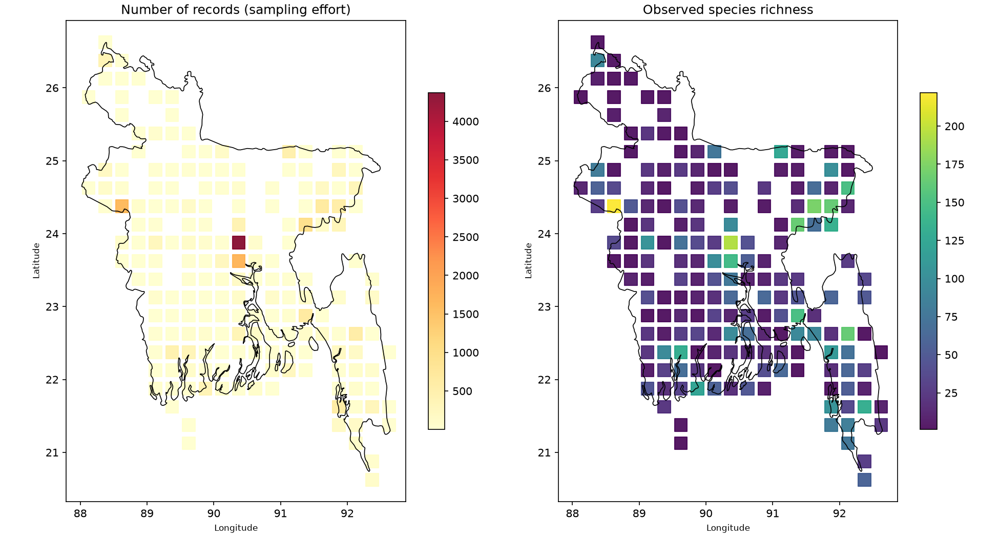
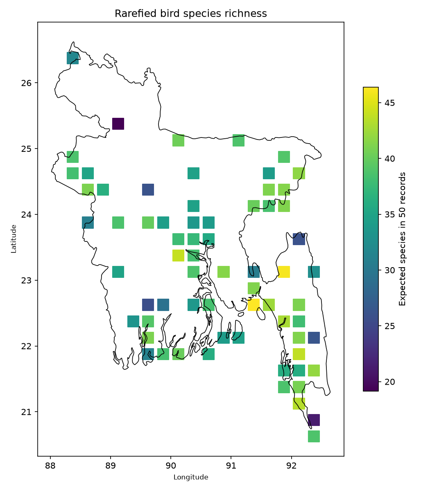

# Bangladesh Bird Biodiversity: Sampling Bias in GBIF Data

## Question

Where are bird species recorded in Bangladesh, and how much does
observed richness reflect real biodiversity versus sampling effort?

## Data

- Bird occurrence records (Aves) from GBIF, country = BD, 2010-2025
- Country borders from Natural Earth
- XXX records after cleaning, XXX species

## Methods

1. Downloaded records by year via the GBIF API (pygbif)
2. Cleaned: removed missing species/coordinates, duplicates, points
   outside Bangladesh, locations with >10 km uncertainty, and
   non-observation records
3. Aggregated records into 0.25 degree grid cells
4. Rarefied richness to 50 records per cell to remove sampling-effort bias
5. Built a species accumulation curve

## Key results

- Observed richness correlated with sampling effort (rho = XXX);
  rarefied richness much less so (rho = XXX)
- Best-sampled areas: XXX. Poorly sampled areas: XXX
- Species accumulation curve: XXX (still rising / flattening)

## Limitations

- Records come from volunteers (mostly eBird/iNaturalist), so they
  are concentrated near cities and popular birdwatching sites
- Grid size (0.25 degrees) was chosen arbitrarily
- No correction for observer skill or detectability

## Reproduce

    python3 -m venv venv && source venv/bin/activate
    pip install -r requirements.txt
    bash run_all.sh

## Author

Your Name, BSc Zoology, University of Chittagong
